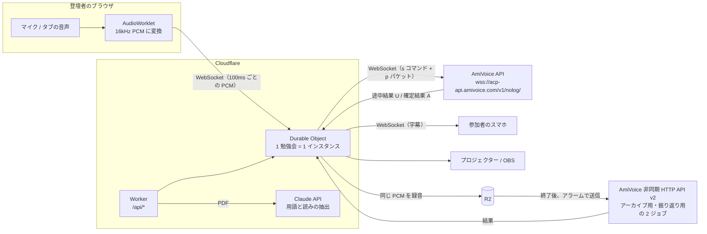

# amivoice-live

勉強会・LT 会の登壇を、リアルタイムに字幕にする Web アプリです。

- 登壇スライドの PDF から、誤認識されやすい技術用語とその読みを Claude が抜き出し、AmiVoice API のユーザー辞書（`profileWords`）に登録します。
- 参加者は QR コードを読むだけで、手元のスマホで字幕を追えます。プロジェクターや OBS に重ねる透過表示もあります。
- 質疑応答で話者が替わると、AmiVoice の話者ダイアライゼーションで話者ごとに色を分けます。
- 認識エンジンが自信を持てなかった語（信頼度の低い語）を点線で示します。読み手は「ここは誤認識かもしれない」と分かります。
- 登壇が終わると、録音を AmiVoice の非同期 HTTP API で認識し直し、精度の高いアーカイブ字幕（話者付きの WebVTT・Markdown）を作ります。
- 同じ録音から、話す速さ・フィラー（「えー」「あのー」）・感情解析による声の勢いの推移をまとめた、登壇者向けの振り返りを作ります。
- 振り返りでは、自信のない語と前後の文脈を Claude に渡し、次の登壇に向けて辞書に足すべき語と読みを提案してもらえます。

## しくみ



- **API キーはサーバ側だけに置きます。** AmiVoice のドキュメントは、ブラウザから直接つながずにプロキシ経由で接続することを推奨しています。Durable Object がその役を担い、同じインスタンスが字幕の配信も受け持ちます。
- **1 つの勉強会に 1 つの Durable Object を割り当てます。** 登壇者の音声を AmiVoice に中継し、途中結果と確定結果を参加者全員に配ります。参加者の接続は WebSocket Hibernation で受けるので、待機中に費用はほとんどかかりません。
- **辞書の書式は、エンジンの種類に合わせて組み立てます。** ハイブリッドエンジン（`-a-general` など）には「表記 読み」を、End to End エンジン（`-a2-ja-general`）には表記だけを単語強調として渡します。
- **途中で切れても続きから字幕を出します。** AmiVoice のセッションが切れたら自動でつなぎ直し、それまでに送った音声の長さを足して、字幕の時刻を通し時刻にそろえます。
- **AmiVoice 側にログを残さない接続先を使います。** WebSocket は `/v1/nolog/` に、非同期 HTTP API は `loggingOptOut=True` を付けて送ります。
- **ライブ字幕とアーカイブを、同じ音声で比べます。** Durable Object は AmiVoice に送る PCM をそのまま R2 にマルチパートアップロードします。終了後のアーカイブはこの録音から作るので、両者の違いはエンジンと処理方式の違いだけになります。
- **終了後の処理は Durable Object のアラームで進めます。** 録音を WAV にしてストリームのまま 2 つのジョブを出し、10 秒ごとに状態を見に行きます。
- **月の使用量に上限を設けます。** 全部の勉強会をまたいで AmiVoice に送った音声の長さを 1 つの Durable Object で数え、`AMIVOICE_MONTHLY_LIMIT_HOURS`（既定 9 時間）に達したら配信を始めさせず、終了後のジョブも出しません。感情分析は別に課金されるので `AMIVOICE_SENTIMENT_LIMIT_MINUTES`（既定 55 分）で別に抑え、超えたら感情分析なしで振り返りを作ります。実際の課金は発話区間だけですが、送った長さ全体を数えて多めに見積もります。1 回の登壇で、ライブ・アーカイブ・振り返りの 3 回分（登壇の長さの 3 倍）を使います。

| ジョブ | エンジン | 指定 | 使い道 |
|---|---|---|---|
| アーカイブ | `-a2b-ja-general`（バッチ用 E2E。非同期では推奨） | `speakerDiarization=True` | 精度の高い字幕と、話者ごとの発話時間 |
| 振り返り | `-a-general`（ハイブリッド） | `sentimentAnalysis=True` `keepFillerToken=1` | 感情解析・フィラー・読み付きの信頼度。フィラーを残せるのはハイブリッドエンジンだけです |

## 動かす

必要なもの: Node.js 22.18 以上、AmiVoice API の API キー、Claude API の API キー（スライドから辞書を作る場合）。

1. AmiVoice API に登録して API キーを取得します（[登録方法](https://acp.amivoice.com/blog/trial_amivoice_api/)）。
2. 依存パッケージを入れ、設定ファイルを作ります。

   ```sh
   npm install
   cp .dev.vars.example .dev.vars   # AMIVOICE_API_KEY と ANTHROPIC_API_KEY を書く
   npm run dev
   ```

3. 表示された URL（例: http://localhost:5173 ）を開き、ルームを作ります。登壇者の画面で「配信を始める」を押して話すと、字幕が出ます。参加者用の URL は QR コードの下にあります。

### API キーなしで試す

AmiVoice のプロトコルを真似るモックサーバがあります。音量で発話を区切り、決まった例文を返します。WebSocket API と非同期 HTTP API の両方に応え、話者ダイアライゼーション・信頼度・フィラー・感情解析の値もそれらしく作って返します。

```sh
npm run mock   # 別のターミナルで
# .dev.vars.example のモック用の 3 行のコメントを外して .dev.vars に書き、AMIVOICE_API_KEY=dummy にして
npm run dev
```

ブラウザを使わずに通しで確かめるときは、次を実行します。配信の終了後、アーカイブと振り返りができるまで待って結果を出します。

```sh
node scripts/smoke.ts --audio 音声ファイル --base http://localhost:5173 --diarization
```

### デプロイ

```sh
npx wrangler r2 bucket create amivoice-live-recordings
npx wrangler secret put AMIVOICE_API_KEY
npx wrangler secret put ANTHROPIC_API_KEY
npx wrangler secret put ADMIN_PASSPHRASE   # 公開環境では、ルームを作るのに合言葉を必須にする
npm run deploy
```

`ADMIN_PASSPHRASE` を設定していない場合、ルームを作れるのは localhost からだけです。

録音には質問者の声も入ります。参加者の画面には「録音中」と表示されますが、勉強会の冒頭でも録音することを伝えてください。録音は振り返りの画面から削除できます。R2 のライフサイクルルールで、一定期間後に自動で消すこともできます（例: `npx wrangler r2 bucket lifecycle add amivoice-live-recordings expire-recordings rooms/ --expire-days 30`）。AmiVoice 側の非同期 API の結果は、処理の完了から 7 日間保存されます。

## 精度と遅延を測る

`eval/` には、字幕アプリと同じ条件（16kHz PCM を 100ms ごとに送信）で AmiVoice API に音声を流し、条件の組み合わせを比べるスクリプトがあります。

### 正解の分かる模擬 LT

`eval/corpus/` に、技術用語の多い 3 本の模擬 LT（Cloudflare Workers・Rust の非同期・RAG の評価）の台本とスライドがあります。macOS の読み上げ（`say`）で音声を作るので、誰でも同じ音声を作り直せます。

```sh
node eval/corpus/build.ts   # eval/data/ に音声・正解・スライドの PDF を作る（say・sox・Google Chrome が必要）
```

- 英語の用語は、日本語話者が話すようにカタカナの読みで読み上げ、正解の書き起こしにはスライドと同じ綴りを使います（台本では `{Durable Objects|デュラブルオブジェクツ}` と書きます）。
- 「えー」などのフィラーを混ぜて読み上げ、正解からは除きます。フィラーの数の正解が分かります。
- 最後に別の声で質疑応答を入れます。話者の正解（誰がいつ話したか）が分かります。
- 静かな部屋の音声（`<id>.wav`）に加えて、残響・帯域の制限・雑音を足した会場の想定（`<id>.venue.wav`）を作ります。
- 台本の読みをそのまま入れた「理想の辞書」（`<id>.oracle.dict.json`）も作ります。スライドから Claude が作った辞書（`node eval/dictionary.ts` で `<id>.slides.dict.json`）がどこまで迫るかを比べる上限の目安です。

読み上げ音声は人の発話より認識しやすいので、数字は「同じ条件どうしの差」を見るためのものです。

### クーポンの範囲で実験する

`eval/stream.ts`・`eval/async.ts`・`scripts/smoke.ts` は、AmiVoice に送る前に音声の長さを台帳（`eval/usage.jsonl`）に記録し、月の合計が 9 時間（`AMIVOICE_BUDGET_HOURS`）を超えるなら実行しません。`--dry-run` で使用量の見積もりだけを出せます。`node eval/budget.ts` で月ごとの使用量を確かめられます。

```sh
# 1. 音声（任意の形式。ffmpeg で変換します）、正解の書き起こし、辞書を用意する
#    辞書は登壇者の画面で作ってから、/api/rooms/<id>/dictionary の JSON を保存するのが手軽です
# 2. ライブ: 全エンジン（多言語 E2E を含む）× 辞書あり/なし を実時間で流す
AMIVOICE_API_KEY=... node eval/stream.ts --audio eval/data/talk.wav --dictionary eval/data/talk.dict.json --matrix
#    発話区間検出の postTime を変えて、字幕の確定の速さと文の切れ方の兼ね合いを測る
AMIVOICE_API_KEY=... node eval/stream.ts --audio eval/data/talk.wav --dictionary eval/data/talk.dict.json --engine=-a-general --post-time 300,550,800,1200
#    E2E エンジンの単語強調の強調度（0〜1、既定 0.5）を変える
AMIVOICE_API_KEY=... node eval/stream.ts --audio eval/data/talk.wav --dictionary eval/data/talk.dict.json --engine=-a2-ja-general --emphasis 0.3,0.5,0.8,1
# 3. 非同期 HTTP API（アーカイブと同じ方式）: バッチ用 E2E とハイブリッド × 辞書あり/なし
AMIVOICE_API_KEY=... node eval/async.ts --audio eval/data/talk.wav --dictionary eval/data/talk.dict.json --matrix
# 4. ライブと非同期をまとめて表にする
node eval/score.ts --reference eval/data/talk.ref.txt --dictionary eval/data/talk.dict.json eval/out/talk.*.jsonl eval/out/talk.*.async.json
# 模擬 LT は、3 本をまとめて条件ごとに集計する（話者の正しさとフィラーの数も正解と比べる）
node eval/summarize.ts --json eval/results/summary.json
```

出力する指標:

| 指標 | 定義 |
|---|---|
| CER | 文字誤り率。NFKC 正規化・英字の小文字化・空白と記号の除去をしてから、編集距離 ÷ 正解の文字数 |
| 辞書語の再現率 | 正解に出てくる辞書語のうち、認識結果にも同じ表記で出てきた割合 |
| 確定まで | 発話終了イベント（E）が届いてから確定結果（A）が届くまでの実時間 |
| 確定の遅れ | 確定結果が届いた時点で送り終えていた音声の位置から、その発話の終了位置を引いた値 |
| 最初の途中結果 | 発話開始イベント（S）から最初の途中結果（U）までの実時間 |

`eval/sample/make-audio.sh` で、手順を試すためのサンプル音声を macOS の読み上げで作れます。

## 開発

```sh
npm run typecheck   # Worker・ブラウザ・Node の 3 つの設定で型チェック
npm test            # プロトコル処理の単体テスト
npm run build
```

| パス | 内容 |
|---|---|
| `src/shared/amivoice.ts` | AmiVoice の WebSocket プロトコル（s コマンド、p パケット、イベントの解釈、辞書の組み立て、フィラーと話者の判定） |
| `src/shared/async-request.ts` | 非同期 HTTP API の `d` パラメータと WAV ヘッダ |
| `src/shared/async-result.ts` | 非同期 HTTP API の結果の解釈と、振り返りレポートの集計 |
| `src/worker/room.ts` | 勉強会ごとの Durable Object（AmiVoice への中継、字幕の配信と保存、録音、終了後のジョブ） |
| `src/worker/recording.ts` | R2 へのマルチパートアップロード（配信中に DO が再起動しても、送ったパートまでは回収できる） |
| `src/worker/async-api.ts` | 非同期 HTTP API のクライアント（録音をストリームのまま送る） |
| `src/worker/usage.ts` | 月ごとの使用量を数え、上限を超える配信やジョブを止める Durable Object |
| `src/worker/terms.ts` | スライドからの用語抽出と、書き起こしからの辞書の提案（Claude の構造化出力） |
| `src/client/` | 登壇者・参加者・振り返り・トップの各画面 |
| `public/pcm-worklet.js` | 音声を 16kHz PCM にする AudioWorklet |
| `scripts/mock-amivoice.ts` | AmiVoice のモックサーバ |
| `eval/` | 精度と遅延の評価（`corpus/` は模擬 LT、`budget.ts` はクーポンの台帳） |

## 制約

- `profileWords` の表記にはスペースを入れられません。スペースは区切り文字として使われるためです。スペースを含む表記（例: `Durable Objects`）は `_` に置き換えて登録します。`_` は認識結果で半角スペースとして返る仕様です。表記に `|` と `:` は使えないので、これらを含む語は登録しません。
- 辞書は認識を始めるときの s コマンドで渡します。配信中に辞書やエンジン、話者の色分けを変えると、数秒かけてセッションを張り直します。
- 話者のラベルは AmiVoice のセッションごとに独立です。配信中にセッションを張り直すと、ライブ字幕の話者の番号が振り直されることがあります。アーカイブは録音全体を 1 回で認識するので、番号は通しでそろいます。
- 途中結果（U）には信頼度が付かないため、点線は確定した字幕にだけ付きます。
- 感情解析の結果は、区間ごとに `starttime`・`endtime` と 20 個のパラメータ（`energy`・`stress`・`concentration`・`hesitation` など）の数値が並ぶ形で返ります。日本語名と値の範囲（例: `energy` は 0〜100、`atmosphere` は -100〜100）は、パラメータ一覧 API（`result-parameters.json`。認識と同じ `Authorization: Bearer` が必要）から引きます。振り返りのグラフは、この範囲で縦軸を描きます。
- End to End エンジンはフィラーを常に取り除くため、フィラーの数は振り返り用のハイブリッドエンジンの結果から数えます。
