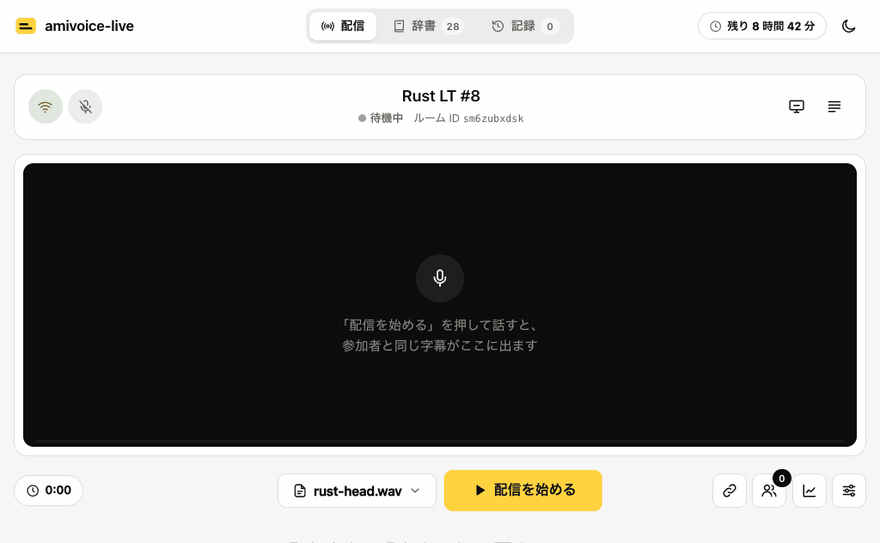
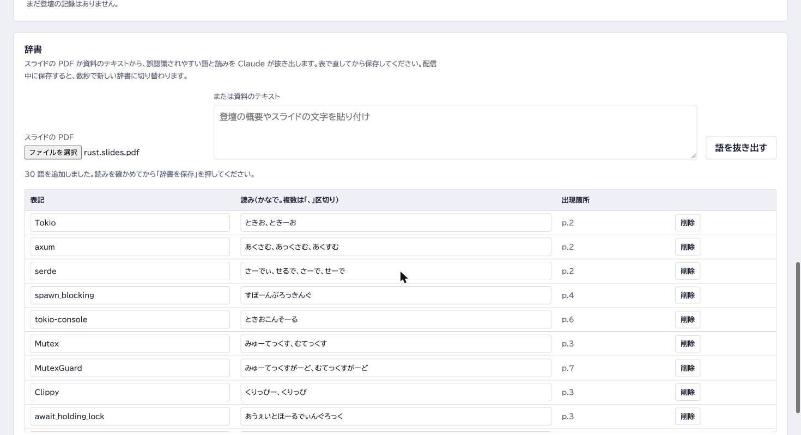
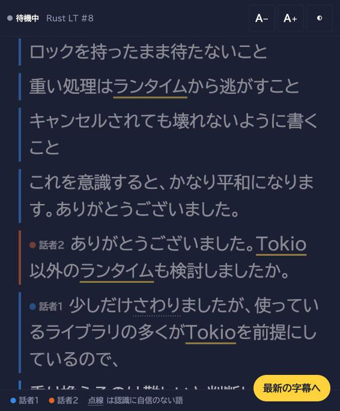
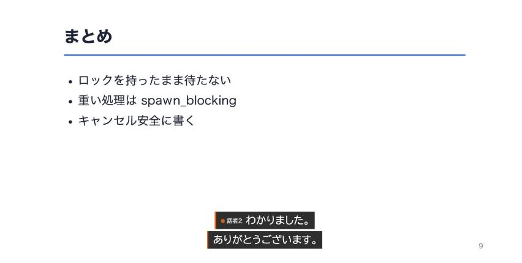
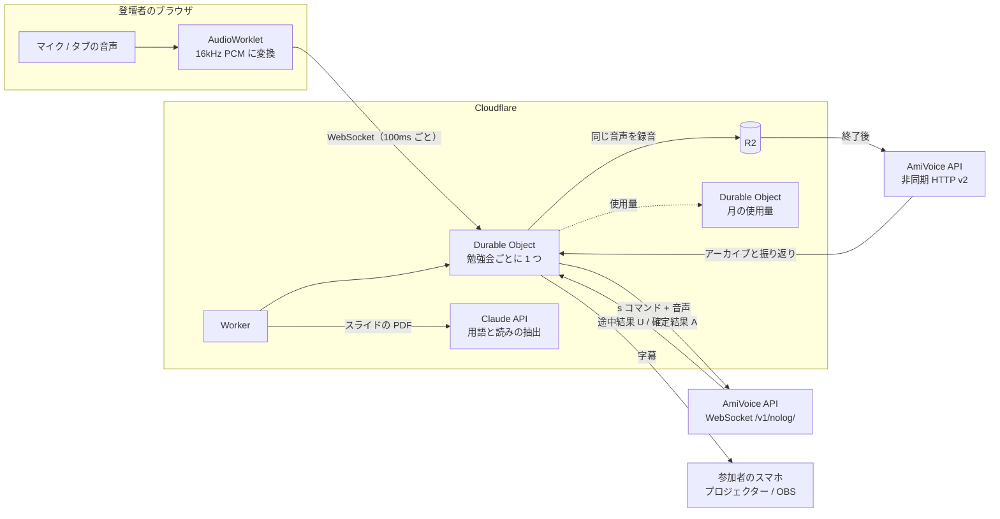
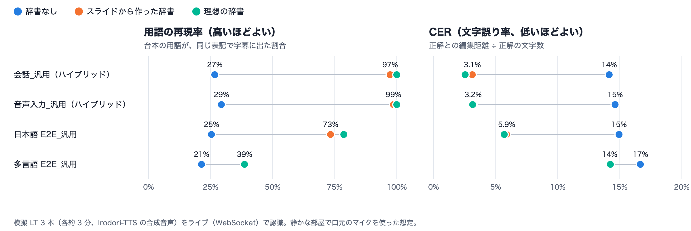
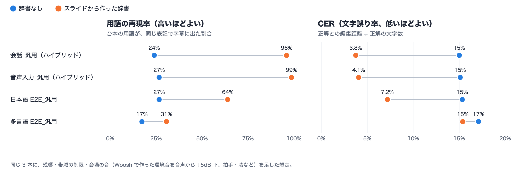
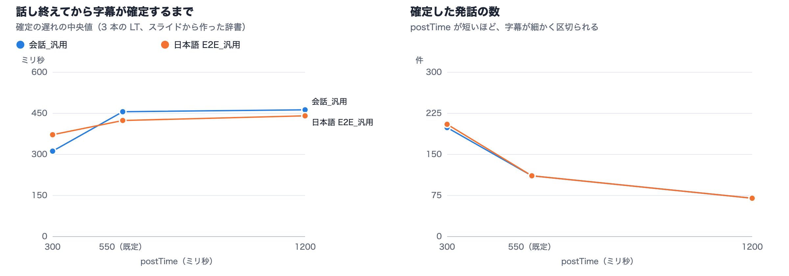
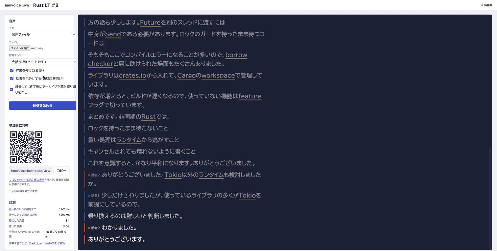

勉強会や LT 会の登壇に、リアルタイムで字幕を付けたいと思いました。
耳の聞こえにくい参加者や、会場の後ろで音が聞き取りにくい参加者も、字幕があれば話を追えます。
配信のアーカイブにも、そのまま字幕を付けられます。

ところが、汎用の音声認識で技術系の登壇を字幕にすると、肝心の技術用語が崩れます。
次は、この記事の実験で使った模擬 LT の一節を、AmiVoice API の汎用エンジンでライブ認識した結果です。

| | 字幕 |
|---|---|
| 台本 | `blockConcurrencyWhile` の中で外部への `fetch` を待つと、その間ほかのリクエストが全部止まってしまいます。 |
| 辞書なし | ブロック今かれん氏whileの中で、外部への設置を待つと、その間、他のリクエストが全部止まってしまいます。 |
| スライドから作った辞書 | blockConcurrencyWhileの中で、外部へのfetchを待つと、その間、他のリクエストが全部止まってしまいます。 |

用語の崩れた字幕は、その分野に詳しい人なら頭の中で読み替えられても、初めてその技術を知る人には混乱のもとになります。
AmiVoice API には、認識を始めるときに語と読みを登録できる単語登録があります。
そして登壇者は、たいてい登壇の前にスライドを用意しています。
そこで、スライドの PDF から Claude に用語と読みを抜き出させ、単語登録に渡すことにしました。

:::message
結果の要約
- 合成音声の模擬 LT 3 本では、スライドから作った辞書で、会話_汎用エンジンの用語の再現率が 27% から 97% に上がり、CER は 14.1% から 3.1% に下がりました。
- 表記しか渡せない End to End エンジンでは、辞書を入れても用語の再現率は 73% にとどまったので、ライブ字幕もアーカイブも、読みを渡せるハイブリッドエンジンで作っています。
- Zenncafe で実際に行われた LT 3 本でも、登壇者の Zenn の記事から作った辞書で、`Mastra` や `Kurage UI` のような固有の名前が正しく出るようになりました。
- その一方で、同じ読みの語が辞書に 2 つあると、辞書なしでは正しかった語まで別の表記に変わることも分かりました。
- 実験は、AmiVoice API のクーポン（月 10 時間）の範囲に収めました。
:::


## 作ったもの

勉強会の主催者がルームを作り、登壇者が自分のノート PC で「登壇者の画面」を開いて話すと、参加者のスマホとプロジェクターに同じ字幕が流れます。


*模擬 LT（Rust の非同期処理の話）の音声ファイルを流したところ。話している途中の文は色を変えて出し、確定したら置き換える。辞書で正しく出た語には下線が付く*

登壇者の画面でやることは 3 つです。

1. スライドの PDF を渡し、Claude が抜き出した語と読みを確かめて辞書を保存する。
2. 認識エンジンを選び、「配信を始める」を押す。質疑応答で話者の色を分けたいときは「話者を色分けする」を入れる。
3. QR コードを参加者に見せる。



参加者は QR コードを読むだけで、手元のスマホで字幕を追えます。
文字の大きさと明暗は参加者ごとに変えられます。
辞書で正しく出た語には下線を、認識エンジンが自信を持てなかった語には点線を付けます。
点線は「ここは誤認識かもしれない」という読み手への注意です。
話者ダイアライゼーションを入れた場合は、発話の左の線の色が話者ごとに変わります。



プロジェクターや配信ソフト（OBS）に重ねるための、背景が透明な表示もあります。



登壇が終わると、同じ音声の録音を AmiVoice の非同期 HTTP API で認識し直し、話者付きのアーカイブ字幕（WebVTT と Markdown）と登壇者向けの振り返りを作ります。
振り返りには、話す速さ、フィラー（「えー」「あのー」）の回数、話者ごとの発話時間、感情解析による声の勢いの推移を並べます。
認識エンジンが自信を持てなかった語とその前後の文脈を Claude に渡し、次の登壇に向けて辞書に足すべき語と読みを提案してもらうこともできます。


上の振り返りでは、ライブ字幕に出た「borrow checker と肩に助けられた」を見て、Claude が「型（かた）」を辞書の候補に挙げています。


## しくみ

全体は、Cloudflare Workers の上で動く 1 つの Web アプリです。
登壇者のブラウザがマイクの音声を送り、勉強会ごとの Durable Object が AmiVoice API に中継して、返ってきた字幕を参加者全員に配ります。



API キーはサーバ側にだけ置きます。
AmiVoice のドキュメントは、ブラウザから直接つなぐのではなく、サーバを経由して接続することを勧めています。
勉強会ごとの Durable Object がその中継役を担い、同じインスタンスが参加者への配信も受け持ちます。
参加者の接続は WebSocket Hibernation で受けるので、誰も話していない待機中には、Durable Object がメモリから退避して課金されません。

ライブの字幕とは別に、AmiVoice に送るのと同じ音声を R2 に録音しておきます。
登壇が終わると、Durable Object のアラームが録音を非同期 HTTP API に送り、録音全体を通して話者のそろったアーカイブ字幕と、登壇者向けの振り返りを作ります。
ライブとアーカイブが同じ音声から作られるので、両者の違いは認識の方式とエンジンの違いだけになります。

## スライドから辞書を作る

AmiVoice API には、認識を始めるときに語を登録できる **単語登録**（`profileWords`）があります。
ただ、登録の書き方はエンジンの世代で違います。
ハイブリッドエンジン（`-a-general` など）には「表記 読み」の組を渡し、エンジンは読みで音を照合します。
End to End エンジン（`-a2-ja-general` など）には表記だけを渡し、エンジンはその表記を出やすくします（単語強調）。
どちらにしても、登壇者が辞書を手で作るのは手間がかかりすぎるので、登壇資料の PDF から Claude に作らせることにしました。

Claude には PDF をそのまま渡し、構造化出力で「表記」「読みの候補」「出てきたページ」の組を返させます。
プロンプトで指示したのは、汎用の音声認識が間違えそうな語だけを選ぶことと、読みを日本語話者の発音で書くことです。
後者の例として、`AWS` には「えーだぶりゅーえす」、`Durable Objects` には「でゅらぶるおぶじぇくつ」のように、カタカナ英語の読みをひらがなで書かせます。
略語は一文字ずつ読む形と単語として読む形の両方を入れさせます（`SQL` なら「えすきゅーえる」と「しーくぇる」）。

返ってきた語は、エンジンに合わせて組み立て直します。

```ts
// ハイブリッド: 「表記 読み」を | でつなぐ。表記のスペースは _ にする（認識結果では半角スペースに戻る）
"Durable_Objects でゅらぶるおぶじぇくつ|Hibernation_API はいばねーしょんえーぴーあい|…"
// End to End: 表記だけ。強調度を付けることもできる
"Durable_Objects|Hibernation_API|…"
```

この辞書がどこまで当たっているかは、後で説明する評価用の模擬 LT で確かめました。
模擬 LT の台本には、読み上げさせた用語とその読みが全部書いてあるので、それを正解の辞書（以下、**理想の辞書**）とみなせます。
スライドから作った辞書を理想の辞書と比べた結果が次の表です。

| LT | 辞書の語数 | 用語の網羅率 | 読みの一致率 | 辞書に入らなかった用語 | 読みが合わなかった用語（台本の読み → 辞書の読み） |
|---|---:|---:|---:|---|---|
| workers | 23 | 95% (18/19) | 94% (17/18) | Workers | Cron Triggers: くーろんとりがー → くろんとりがーず/くーろんとりがーず |
| rust | 28 | 94% (16/17) | 94% (15/16) | HTTP | serde: さーでぃ → さーでぃー/せるで/さーで/せーで |
| rag | 24 | 100% (17/17) | 94% (16/17) | – | Cohere Rerank: こーひありらんく → こひあーりらんく/こひありらんく |

網羅率は、台本の用語のうち辞書に表記が入っていた割合です。
読みの一致率は、辞書に入っていた用語のうち、台本の読みが辞書の読みの候補のどれかと一致した割合です。

Claude はスライドに書かれた用語の大半を拾い、読みも台本と一致しました。
拾えなかったのは、スライドに書かれていない語（`HTTP`）と、スライドとは違う形で口にした語（スライドには `Cloudflare Workers` とだけあり、口頭では単に「ワーカーズ」と言った）です。
前者は、スライドだけを手がかりにする限り避けられない漏れです。
後者は、Claude に「長い名前の一部だけで呼ぶこともある語は、その形も入れる」と指示すれば減らせる可能性があります。
読みが合わなかった語も、「くーろんとりがー」と「くろんとりがーず」のような長音や複数形の違いでした。

## どれくらい効くのかを測る

### 正解の分かる模擬 LT

辞書の効果を測るには、正解の書き起こしが付いた LT の音声が要ります。
自分の登壇の録音を書き起こせば作れますが、それでは読者が同じ実験をやり直せません。
そこで、技術用語の多い 3 本の模擬 LT の台本を書き、ローカルで動く音声合成モデルで音声にしました。
読み上げには [Irodori-TTS](https://github.com/Aratako/Irodori-TTS)（`Aratako/Irodori-TTS-v4.1-Small`）を使いました。
Irodori-TTS は、声の特徴を文章で指定して声を作れる（VoiceDesign）日本語の音声合成モデルで、Apple シリコンの Mac でも動きます。

| LT | 内容 | 長さ | 話す速さ | 用語 |
|---|---|---:|---:|---:|
| workers | Cloudflare Workers でリアルタイムチャットを作った話 | 214 秒 | 344 文字/分 | 19 種 25 回 |
| rust | Rust の非同期処理でデッドロックを踏んだ話 | 193 秒 | 332 文字/分 | 17 種 23 回 |
| rag | 社内ボットの RAG を測りながら直した話 | 203 秒 | 305 文字/分 | 17 種 19 回 |

台本には、読み上げ用の読みと正解の表記を並べて書きます。

```text
[A]
(えー)、それでは始めます。今日は{Cloudflare Workers|クラウドフレアワーカーズ}で、勉強会向けの…
[B]
ありがとうございました。質問なんですが、部屋の数がすごく増えたときに…
```

この書き方には、3 つの狙いがあります。

- **カタカナの読み**：英語の用語は、日本語話者が口にするようにカタカナの読みで読み上げさせ、正解の書き起こしにはスライドと同じ綴り（`Cloudflare Workers`）を使います。辞書がなければ、認識結果はカタカナや別の語になるはずです。
- **フィラー**：「えー」「あのー」を混ぜて読み上げ、正解からは除きます。振り返りで数えるフィラーの正解が分かります。
- **質疑応答**：最後に別の声で質問を入れます。誰がいつ話したかの正解が分かるので、話者の色分けの正しさを測れます。

話者の声は、台本の先頭に書いた説明から作ります。

```text
# voice A: 20代後半の男性エンジニア。勉強会のライトニングトークで、聴衆に向けて明るくはきはきと、やや早口で話している。ピンマイクで録った近くてクリアな声。
# voice B: 30代の女性エンジニア。勉強会の客席からマイクを受け取り、落ち着いた丁寧な口調で登壇者に質問している。
```

説明だけを条件にして 1 文ずつ合成すると、文ごとに声が少しずつ変わってしまいます。
そこで、説明から話者ごとの参照音声を 1 本作り、以後の文は参照音声と説明の両方を条件にして合成しました。
1 文ずつ作るので、文の間、段落の間、話者の交代の間の無音の長さは台本の構造から決まり、正解の時刻も正確に分かります。

音声合成モデルは、ときどき語を読み飛ばしたり、文の後ろに台本にない音を付けたりします。
それが正解の書き起こしに紛れると、認識エンジンの誤りとして数えてしまいます。
そこで、1 文ごとに話す速さと文の中の無音の長さを測り、極端な文は seed を変えて合成し直しました。
仕上がった音声は、ローカルの Whisper（`large-v3-turbo`）でも書き起こして台本と比べました。
違いは用語の書き方（「ラスト」と `Rust`）と、無音の区間に Whisper が出す決まり文句（「ご視聴ありがとうございました」）だけで、読み飛ばしや繰り返しは見つかりませんでした。

静かな部屋で口元のマイクを使った想定の音声に加えて、会場の想定の音声も作りました。
帯域を 120Hz〜6.5kHz に絞り（安いマイクと PA の代わり）、残響を足し、会場の音を重ねます。
会場の音は、Sony AI の効果音生成モデル [Woosh](https://github.com/SonyResearch/Woosh) で作りました。
空調の音と客席の気配の環境音を音声全体の RMS から 15dB 下で流し続け、登壇の終わりと質疑の後には拍手を、段落の間には咳、椅子のきしみ、キーボードの音を 1 回ずつ入れます。
合成の seed を固定しているので、同じ環境なら何度作っても同じ音声になります。

合成音声で測ることには限界があります。
人の話し方と比べると言い直しや言いよどみは台本に書いたものしかなく、マイクとの距離が変わることもありません。
そのため、ここで出す数字は「この条件ならこれだけ正確」という絶対値ではなく、同じ音声で条件を変えたときの差として読んでください。
人の話し方でどうなるかは、結果の最後で、実際の登壇の動画を使って確かめています。

### 指標

認識結果は、次の指標で正解と比べます。

- **CER**（文字誤り率）：NFKC 正規化、英字の小文字化、空白と記号の除去をしてから、正解との編集距離を正解の文字数で割った値。カタカナと英字の違い（「デュラブル」と `Durable`）は誤りとして数えます。辞書で直したいのはまさにその誤りだからです。
- **用語の再現率**：台本の用語が正解に出てくる回数のうち、認識結果にも同じ表記で出てきた回数の割合。辞書の中身ではなく台本の用語で数えるので、辞書を変えても同じ物差しで比べられます。
- **確定まで**：発話の終わり（E イベント）が届いてから、確定した結果（A イベント）が届くまでの時間。
- **確定の遅れ**：確定した結果が届いた時点で送り終えていた音声の位置から、その発話の終わりの位置を引いた値。話し終えてから字幕が確定するまでの体感に近い値です。

ライブの測定は、字幕アプリと同じ条件（16kHz の PCM を 100 ミリ秒ごとに実時間で送る）で、WebSocket に音声を流して行いました。

### クーポンの範囲に収める

このコンテストでは、AmiVoice API を 11 月と 12 月に月 10 時間無料で使えるクーポンが配られています。
マイページで確かめると、クーポンの 32,400 秒（9 時間）は、もともとの無料枠 3,600 秒とは別に、エンジンごと、ログ保存の有無ごと、方式（WebSocket と非同期）ごとに付いていました。
課金されるのは発話区間だけで、無音は数えません。

それでも、条件を掛け合わせる実験は、気を抜くとすぐに時間を使います。
そこで、評価スクリプトが音声を送る前に、その長さを台帳（`eval/usage.jsonl`）に記録し、月の合計が 9 時間を超える実行は始めないようにしました。
台帳は無音も含めた音声の長さ全体を数え、エンジンも区別しないので、実際の枠よりかなり厳しめの見積もりです。
認証に失敗したときのように、認識を始められなかった実行は音声を送らないので、記録しません。

```console
$ node eval/budget.ts
## 2026-11: 8 時間 8 分 / 上限 9 時間 0 分（残り 52 分）、うち感情分析 6 分
- -a-general（WebSocket）: 2 時間 25 分
- -a2-ja-general（WebSocket）: 2 時間 0 分
- -a-general-input（WebSocket）: 1 時間 18 分
- -a2-multi-general（WebSocket）: 1 時間 0 分
- -a-general（非同期）: 47 分
- -a2b-ja-general（非同期）: 37 分
```

この記事の実験（実際の登壇で試した分も含む）と、アプリの動作確認を合わせて、台帳の上で 8 時間 8 分でした。
エンジンと方式ごとに分けると、どれも 1 つあたりのクーポン（9 時間）の 3 割に満たない量です。

アプリ本体にも同じ考え方の上限を入れました。
全部の勉強会をまたいで送った音声の長さを 1 つの Durable Object で数え、上限（既定 9 時間）に達したら配信を始めさせず、終了後のジョブも出しません。
公開した字幕アプリを誰かが長時間使い続けても、クーポンを使い切った先で課金が始まらないようにするためです。

## 結果

### 辞書はどれくらい効いたか

静かな音声を 4 つのエンジンでライブ認識し、辞書なし、スライドから作った辞書、理想の辞書の 3 通りで比べました。



会話_汎用エンジン（`-a-general`）では、スライドから作った辞書で用語の再現率が 27% から 97% に上がり、CER は 14.1% から 3.1% に下がりました。
理想の辞書（再現率 100%、CER 2.5%）との差はわずかです。
音声入力_汎用エンジン（`-a-general-input`）も、ほぼ同じ傾向でした。

辞書がないと、用語はカタカナになるだけでなく、別の語に化けます。
会話_汎用エンジンで rust の LT を辞書なしで認識すると、`Mutex` は「ニューテック酢」に、`serde` は「さあD」に、`Clippy` は「クオリティ」に、`Send` は「鮮度」になりました（「中身が鮮度である必要があります」）。
スライドから作った辞書を入れると、これらはすべてスライドと同じ綴りで出ました。

スライドから作った辞書でも取りこぼした 75 回中 2 回は、それぞれ別の理由によるものです。
1 つは、辞書に入っていなかった語です（workers の LT で、`Cloudflare Workers` を略して「ワーカーズ」と言った箇所）。
もう 1 つは、表記は辞書に入っていたのに、読みが合わなかった語です。
rag の LT の `Cohere Rerank` は「こーひありらんく」と読み上げましたが、Claude が付けた読みは「こひあーりらんく」と「こひありらんく」でした。
ハイブリッドエンジンは読みで音を照合するので、読みが外れると辞書があっても「ヒヤリランク」のままでした。
辞書の表の確認で読みを直す手間は、ここに効きます。

:::details 静かな音声の全条件の数値（3 本の合計）
| エンジン | 辞書 | CER | 用語の再現率 | 確定の遅れ p50 |
|---|---|---:|---:|---:|
| 会話_汎用 | なし | 14.1% | 26.7% (20/75) | 454 ms |
| 会話_汎用 | スライドから | 3.1% | 97.3% (73/75) | 456 ms |
| 会話_汎用 | 理想 | 2.5% | 100.0% (75/75) | 414 ms |
| 音声入力_汎用 | なし | 14.6% | 29.3% (22/75) | 360 ms |
| 音声入力_汎用 | スライドから | 3.2% | 98.7% (74/75) | 360 ms |
| 音声入力_汎用 | 理想 | 3.1% | 100.0% (75/75) | 410 ms |
| 日本語 E2E_汎用 | なし | 14.9% | 25.3% (19/75) | 424 ms |
| 日本語 E2E_汎用 | スライドから | 5.9% | 73.3% (55/75) | 424 ms |
| 日本語 E2E_汎用 | 理想 | 5.7% | 78.7% (59/75) | 394 ms |
| 多言語 E2E_汎用 | なし | 16.7% | 21.3% (16/75) | 528 ms |
| 多言語 E2E_汎用 | スライドから | 14.2% | 38.7% (29/75) | 536 ms |
| 多言語 E2E_汎用 | 理想 | 14.2% | 38.7% (29/75) | 532 ms |
:::

### 会場の音を足すと

会場の想定の音声でも、辞書の効き方はほとんど変わりませんでした。



会話_汎用エンジンでは、辞書なしの CER が 15.0%（静かな音声では 14.1%）、スライドから作った辞書で 3.8%（同 3.1%）でした。
今回足した会場の音は、空調と拍手が音声より 15dB 小さい程度の、比較的おだやかな条件です。
スピーカーから出た声をマイクで拾い直すような、もっと厳しい会場での結果は、この実験からは言えません。

### End to End エンジンでは、辞書の効き方が違う

日本語 E2E_汎用エンジン（`-a2-ja-general`）は、辞書なしの CER がハイブリッドエンジンとほぼ同じ（14.9%）でしたが、辞書を入れたときの伸びが小さく、用語の再現率は 73% にとどまりました。
理想の辞書でも 79% です。
読みを渡せない単語強調では、エンジンが音から綴りを組み立て直すことになり、`Recall@10` が「Recal Wat 10」に、`Durable Objects` が「Urable Objects」になるような、半端な英字が出ました。
多言語 E2E_汎用エンジン（`-a2-multi-general`）は、辞書を入れても再現率が 39% で、日本語の技術系の登壇には向きませんでした。

単語強調には強調度（0〜1、既定 0.5）があるので、0.3 と 1 も試しました。

| 強調度 | CER | 用語の再現率 |
|---:|---:|---:|
| 0.3 | 6.9% | 66.7% (50/75) |
| 0.5（既定） | 5.9% | 73.3% (55/75) |
| 1 | 5.8% | 76.0% (57/75) |

強調度を 1 にしても再現率は 76% で、ハイブリッドエンジンの 97% には届きませんでした。
強めるほど、辞書の別の語に引き寄せられる誤りも増えます。
強調度 1 では、rust の LT の `Future` が 2 回とも `feature` になり、`Clippy` は「Clip」に、`Durable Objects` は「Urabot」になりました。
技術用語を辞書で直したいライブ字幕には、読みを渡せるハイブリッドエンジンのほうが合っています。

### 辞書の副作用

辞書に入れた語が、関係のない箇所に出ることもありました。
workers の LT の「キーと値を読み書きする」は、会場の音声を会話_汎用エンジンで認識したとき、辞書なしでは正しく出たのに、スライドから作った辞書を入れると「Vite値を読み書きする」になりました。
静かな音声では辞書の有無にかかわらず「シート値」「チート値」と崩れていたので、もともと聞き取りにくい箇所が、辞書の語（`Vite`）に引き寄せられた形です。
日本語 E2E_汎用エンジンでは、rust の LT の `Future` が、辞書にあった別の語の `feature` になりました。
どちらも、辞書の語を増やすほど起きやすくなると考えられます。
スライドの全部の語を入れるのではなく、汎用の認識で崩れそうな語に絞るよう Claude に指示しているのは、このためです。

### 字幕が確定するまでの速さ

ライブ字幕では、話し終えてから字幕が確定するまでの時間も読みやすさに関わります。
AmiVoice API は、無音が `postTime`（WebSocket では既定 550 ミリ秒）続いたところで発話の終わりとみなします[^posttime]。
これを 300 と 1200 に変えて、スライドから作った辞書で 3 本を流しました。



会話_汎用エンジンでは、300 にすると確定の遅れの中央値が 456 ミリ秒から 312 ミリ秒に縮みました。
その代わりに確定した発話の数が 111 から 199 に増え、文の途中で字幕が切れるようになりました。

```text
postTime=300   仕事でログを集めて別のサービスに送る。
               小さなエージェントをRustで書いています。
既定（550）    仕事でログを集めて別のサービスに送る小さなエージェントをRustで書いています。
```

途中で切れた文には、もとの文にない句点が付いています。
1200 にすると、発話の数は 70 に減って 1 つの字幕に 2 文以上が入るようになり、遅れの中央値はほとんど変わりませんでした（463 ミリ秒）。
CER への影響は会話_汎用エンジンでは小さく（3.1% に対して 2.9% と 3.4%）、日本語 E2E_汎用エンジンでは 300 にすると 5.9% から 7.6% に悪化しました。
LT の字幕は文の単位で読めるほうがよいので、このアプリでは既定の 550 のままにしています。

[^posttime]: [Speech Detection](https://docs.amivoice.com/en/amivoice-api/manual/vad)。非同期 HTTP API の既定は 800 ミリ秒です。

### 質疑応答の話者を分けられたか

模擬 LT の最後には、別の声の質問者による質疑応答（質問、登壇者の回答、質問者のお礼）を入れています。
ライブ字幕に話者ダイアライゼーション（`useDiarizer=1`）を入れて 3 本を流すと、会話_汎用エンジンでも日本語 E2E_汎用エンジンでも、どの LT でもラベルはちょうど 2 種類になり、正解の話者との対応は文字単位で 100% でした[^speaker]。
話者の色を分けても、CER と用語の再現率は分けないときと変わりませんでした。



ただし、今回の登壇者と質問者は、声の説明を「20 代後半の男性」と「30 代の女性」のように大きく変えて作っています。
声の似た 2 人が話す場合や、客席のマイクが遠い場合にどこまで分けられるかは、この実験では確かめていません。

[^speaker]: ラベルごとに、そのラベルの付いた文字が最も多く属する正解の話者を対応させ、正しく対応した文字の割合を数えました。

### アーカイブのエンジンを選び直す

登壇が終わったあとのアーカイブでは、録音全体を非同期 HTTP API で認識し直します。
非同期 HTTP API には、バッチ処理用の End to End エンジン（`-a2b-ja-general`）が用意されています。
最初はアーカイブをこのエンジンで作っていましたが、ライブと同じ会話_汎用エンジンとも比べました。
どちらも話者ダイアライゼーションを入れ、3 本の合計で数えています。

| エンジン | 音声 | 辞書 | CER | 用語の再現率 |
|---|---|---|---:|---:|
| 日本語 E2E_汎用（バッチ用） | 静か | なし | 14.8% | 25.3% (19/75) |
| 日本語 E2E_汎用（バッチ用） | 静か | スライドから | 7.2% | 69.3% (52/75) |
| 日本語 E2E_汎用（バッチ用） | 会場 | スライドから | 9.1% | 58.7% (44/75) |
| 会話_汎用 | 静か | なし | 13.9% | 29.3% (22/75) |
| 会話_汎用 | 静か | スライドから | 3.4% | 96.0% (72/75) |
| 会話_汎用 | 会場 | スライドから | 3.5% | 96.0% (72/75) |

辞書がないときは 2 つのエンジンにほとんど差がありません。
差が開くのは辞書を入れたときで、ライブの End to End エンジンと同じく、バッチ用のエンジンも読みを渡せないぶん辞書が効きにくく、用語の再現率は 69% にとどまりました。
そこで、アーカイブも会話_汎用エンジンで作るように変えました。

会話_汎用エンジンどうしで比べると、録音全体を認識し直したアーカイブ（CER 3.4%）は、ライブ字幕（3.1%）より正確にはなりませんでした。
アーカイブで得られるのは精度ではなく、録音全体で番号のそろった話者のラベルです。
質疑応答の質問者の発話は、静かな音声では 100%、会場の音声でも 99.4% が質問者のラベルに分かれました。

### 振り返りのフィラーの数

振り返りのフィラーは、非同期 HTTP API に `keepFillerToken=1` を付けて会話_汎用エンジンで認識し、`%えー%` のように印の付いた語を数えています。
台本に入れたフィラー 17 回（3 本の合計）は、すべてフィラーとして数えられました。
表記は「えっと」が「えっとー」に、「まあ」が「まー」になるなど、台本とは少し違います。

その代わりに、台本にないフィラーも 3 回数えました。
1 回は rag の LT の `Cohere Rerank` で、「こーひありらんく」の頭の「こー」をフィラーとみなし、残りを「日明ランク」と書き起こしていました。
残りの 2 回は workers の LT で、合成音声のその位置に台本にない音が入っていたのか、認識の誤りなのかは確かめていません。
振り返りのフィラーの回数は、目安として読むのがよさそうです。

### 実際の登壇で試す

ここまでの数字は、合成音声の模擬 LT で測ったものです。
人の話し方でも辞書が効くのかを見るため、Zenn のユーザーグループ Zenncafe の第 3 回（2025 年 7 月）の LT のうち、YouTube で公開されている LT のうち 3 本でも試しました。
登壇者のうち 2 人は、登壇と同じ内容を Zenn の記事にも書いています。
そこで、スライドの代わりに記事の本文を、アプリの「資料のテキスト」と同じ処理に渡して辞書を作りました。
記事のない 1 本は、動画のタイトルと概要文（2 文）だけから作っています。

| LT | 長さ | 辞書の元 | 辞書の語数 |
|---|---:|---|---:|
| [Mastra×RAG×構造化ストリーミングの開発事例](https://www.youtube.com/watch?v=gRz3W8uGnaQ) | 345 秒 | [登壇者の Zenn の記事](https://zenn.dev/manalink_dev/articles/teacher-search-agent-by-mastra) | 60 |
| [自社UIコンポーネントにMCPサーバーを作った話](https://www.youtube.com/watch?v=m1Y1QhJUN2k) | 282 秒 | [登壇者の Zenn の記事](https://zenn.dev/uniformnext/articles/kurage-ui-mcp) | 40 |
| [TSパターンとリザルト型でAIが変わる!?](https://www.youtube.com/watch?v=0KOvMZw79-E) | 255 秒 | 動画のタイトルと概要文 | 8 |

動画の音声を 16kHz に変換し、模擬 LT と同じく実時間で会話_汎用エンジンに流して、辞書なしと辞書ありを比べました。
正解の書き起こしがないので CER は出せません。
代わりに、同じ時刻の字幕を並べて、用語がどう変わったかを見ました。

| LT | 辞書なしの字幕 | 辞書ありの字幕 |
|---|---|---|
| Mastra | マスター（2 回） | `Mastra` |
| Mastra | リアルのネイティブ、ネクストJS | `React Native`、`Next.js` |
| Mastra | ジェイソン、ジェーソン | `JSON` |
| MCP | くらげUI、クラゲ上、蔵際、くら際、クラゲ祝い | `Kurage UI`（6 回とも） |
| MCP | 部コンテナ | `DevContainer` |
| MCP | 前（好きなものは前と…） | `Zenn` |
| ts-pattern | TSパターン、DSパターン | `ts-pattern`（6 回とも） |
| ts-pattern | リザルト方、木皿と肩 | `Result型` |
| ts-pattern | 片安全 | `型安全` |

自社の UI コンポーネントライブラリの名前（`Kurage UI`）は、辞書がないと 6 回とも違う字幕になりました。
こうした固有の名前は、汎用の認識エンジンが知りようのない語であり、登壇者の書いた記事から辞書を作る効果がいちばんはっきり出たところです。
概要文 2 文から作った 8 語の辞書でも、タイトルにある 2 つの用語は、登壇中に何度出てきても同じ表記になりました。
ただし、概要文に書かれていなかったライブラリ名（`neverthrow`）は、辞書なしと同じく崩れたままでした。

模擬 LT では見なかった副作用も 2 つ出ました。
1 つは、辞書の語どうしの読みの重なりです。
MCP の LT の辞書には、本文の `MCP サーバー` と、記事のコードに出てくるクラス名の `McpServer` が、同じ読み（えむしーぴーさーばー）で入っていました。
すると、辞書なしでは正しく「MCPサーバー」と出ていた 3 か所が、`McpServer` になりました。
ハイブリッドエンジンは読みで照合するので、同じ読みの語が 2 つあると、どちらの表記が出るかはエンジン次第です。
そこで、辞書の表で同じ読みの語に印を付け、片方を消すか読みを変えるよう表の上に書くようにしました。

もう 1 つは、エンジンがもともと知っていた語が、辞書の語に分けられたことです。
Mastra の LT の辞書には `Claude` はあっても `Claude Code` はなく、辞書なしでは 3 回とも正しく出ていた「Claude Code」が、辞書を入れると 3 回とも「Claudeコード」になりました。
`Claude Code` を辞書に入れていた MCP の LT では、正しく出ています。
長い名前の一部を辞書に入れるときは、その名前全体も入れておくのが安全です。

## AmiVoice API でつまずいたところ

### カードを登録した直後は、API キーが通らない

AmiVoice API の API キーは、クレジットカードを登録すると使えるようになります。
ただ、登録の直後に接続すると、s コマンドが `received illegal service authorization` などで失敗しました。
今回は、登録からおよそ 10 分後に通るようになりました。
登録の直後に試して失敗しても、キーの写し間違いとは限りません。

### 単語登録の表記にスペースを入れられない

`profileWords` では、半角スペースが表記と読みの区切りです。
そのため `Durable Objects` のような表記はそのままでは登録できません。
表記の `_` は認識結果で半角スペースとして返る仕様なので、スペースを `_` に置き換えて登録します。

```ts
export function encodeWritten(written: string): string {
  return written.trim().replace(/\s+/g, "_");
}
```

表記に `|` と `:` も使えないので、これらを含む語は登録から外しています。

### End to End エンジンでは、単語登録の意味が変わる

ハイブリッドエンジンの単語登録は「表記と読みの組」を教えるもので、エンジンは読みで音を照合します。
End to End エンジンでは表記だけを渡し、その表記を出やすくする「単語強調」になります。
強調度（0〜1、既定 0.5）を付けるときは `表記  0.8` のように書きます（代替表記を省いた形）。
同じ辞書から両方の書式を組み立てられるよう、辞書には表記と読みを両方持たせ、エンジンの種類で組み立て方を変えました。

### フィラーを残せるのはハイブリッドエンジンだけ

振り返りでフィラー（「えー」「あのー」）を数えるため、非同期 HTTP API に `keepFillerToken=1` を付けました。
ところが、End to End エンジンはこの指定があってもフィラーを取り除いた結果を返します。
振り返りのジョブは、フィラーと感情解析のためにハイブリッドエンジン（`-a-general`）で出しています。

### 途中結果には信頼度が付かない

確定結果（A イベント）には単語ごとの信頼度が付きますが、途中結果（U イベント）には付きません。
自信のない語を点線で示す表示は、確定した字幕にだけ出します。

### 非同期 HTTP API に、録音をストリームのまま送る

非同期 HTTP API は、音声をマルチパートで送ります。
Workers のメモリに数十 MB の録音を載せたくないので、R2 から読んだ録音をストリームのまま送りたいところです。
しかし、長さの分からないストリームを `fetch` に渡すとチャンク転送になり、`Content-Length` が付きません。
そこで、マルチパートの前後の文字列と WAV ヘッダの長さを先に計算し、`FixedLengthStream` に流し込んで `Content-Length` 付きで送りました。

### 話者のラベルは、セッションごとに振り直される

WebSocket の話者ダイアライゼーション（`useDiarizer=1`）は、セッションの中で `speaker0` や `speaker1` のようにラベルを付けます。
辞書を変えるなどでセッションを張り直すと、同じ人に別のラベルが付くことがあります。
ライブ字幕の話者の色はセッションの中でだけそろうものとして扱い、通しでそろった話者は、録音全体を 1 回で認識するアーカイブで出しています。

### 同時に何本も流すと、まれに接続が途絶える

評価では、同じ音声を条件を変えて最大 9 本同時に流しました（いまのスクリプトは最大 8 本）。
その中の 1 本で、s コマンドの応答のあとにイベントが 1 つも届かないまま終わり、続く接続も失敗したことがありました。
評価スクリプトは、確定結果が 1 件も届かなかった実行や途中で切れた実行を、少し待ってから 2 回までやり直すようにしています。


## 動かし方

ソースコードは GitHub に置いています。

<!-- TODO: リポジトリを公開したら URL を入れる -->

```sh
git clone https://github.com/ponyo877/amivoice-live.git
cd amivoice-live
npm install
cp .dev.vars.example .dev.vars   # AMIVOICE_API_KEY と ANTHROPIC_API_KEY を書く
npm run dev
```

表示された URL を開いてルームを作り、登壇者の画面で「配信を始める」を押して話すと、字幕が出ます。
API キーがなくても、AmiVoice のプロトコルを真似たモックサーバ（`npm run mock`）で一通り動かせます。

記事の実験は、次のコマンドで流し直せます。
台帳で月 9 時間を超える実行は始めないので、クーポンの範囲で止まります。

```sh
IRODORI_TTS_DIR=... WOOSH_DIR=... AMIVOICE_API_KEY=... ANTHROPIC_API_KEY=... sh eval/run-experiments.sh
```


「実際の登壇で試す」の比べ方は、手元の録音で次のようにやり直せます（動画の音声はリポジトリに含めていません）。
スライドの代わりに、Zenn の記事の URL やテキストファイルから辞書を作れます。

```sh
ANTHROPIC_API_KEY=... node eval/text-dictionary.ts eval/data/talk.zenn.dict.json https://zenn.dev/<user>/articles/<slug>
AMIVOICE_API_KEY=... node eval/stream.ts --audio eval/data/talk.wav --engine=-a-general --dictionary eval/data/talk.zenn.dict.json --baseline
node eval/compare.ts eval/data/talk.zenn.dict.json eval/out/talk.a-general.nodict.jsonl eval/out/talk.a-general.zenn.jsonl
```

## おわりに

登壇前の資料から作った辞書は、合成音声の模擬 LT でも Zenncafe の実際の LT でも、汎用の認識エンジンが崩していた技術用語を、資料と同じ表記に直しました。
特にはっきり効いたのは、自社のライブラリ名のように、汎用のエンジンが知りようのない語です。
まだ確かめていないのは、会場のスピーカーから出た声を遠いマイクで拾うような厳しい条件と、声の似た 2 人による質疑応答です。
次は勉強会で実際に使って、確かめたいと思います。
